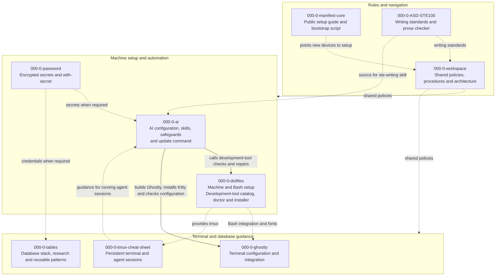

# 000-0-manifest-core

Public setup guide for a new device. It shows how the core repositories fit together. The private repository inventory is kept elsewhere.

## Core repository connections

Solid arrows show operational connections. Dotted arrows show guidance, navigation, or support.

Workspace policies and STE writing rules apply to all nine core repositories. The new-device bootstrap script prepares a blank computer to run the update command.
